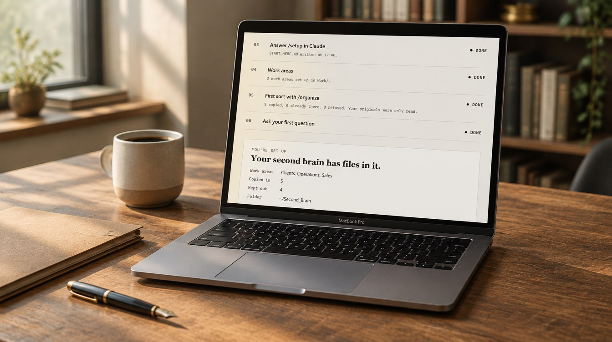

# Heimdall: Entrepreneur Edition

Heimdall is a second brain: a folder on your computer that Claude answers from. Free. You need a Claude Pro or Max plan, which includes Claude Code.

## Install with one line

**Windows**: open PowerShell (Start menu, type PowerShell, press Enter) and paste:

    irm https://raw.githubusercontent.com/bradykrowe/Heimdall-Entrepreneur_Edition/v0.1.0-beta/get.ps1 | iex

**Mac**: open Terminal (Cmd-Space, type Terminal, press Enter) and paste:

    curl -fsSL https://raw.githubusercontent.com/bradykrowe/Heimdall-Entrepreneur_Edition/v0.1.0-beta/get.sh | bash

It downloads the installer from the release below, checks it against its published fingerprint, and runs it. Prefer to click? Download the zip from the release, unzip it, and double-click Install.cmd (Windows) or Install.command (Mac).

Then open the new Second_Brain folder in Claude Code and type /setup, then /organize Downloads. /organize copies files in. It never moves, renames or deletes your originals, and it keeps tax, bank, ID, medical and password files out.

The full guide is README.md inside the zip.
